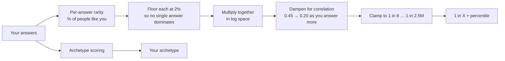

<div align="center">

# 1 in X

### Find out how rare you really are, right in your terminal.

Answer a few questions. Get your **1 in X** rarity score, percentile, archetype and rarest traits.
No accounts. No internet. No dependencies.

[](https://nodejs.org)
[](LICENSE)
[](CONTRIBUTING.md)

[Quick start](#quick-start) · [How it works](#how-the-score-works) · [Browser demo](https://luciferalive.github.io/1inX/) · [Contribute](#contributing) · [Report a bug](../../issues/new?template=bug_report.md)

</div>

---

## Quick start

You only need [Node.js](https://nodejs.org) 18 or newer.

```bash
git clone https://github.com/luciferalive/1inX.git
cd 1inX
node cli/bin/1inx.mjs
```

That's it. Answer the questions (press **Enter** to skip one, **q** to finish early) and you get something like this:

```text
✨ Your result

   You are  1 in 68,711
   Rarer than 99.97% of people
   ████████████████████████████████

   🌍  Global Deal Maker  — Borders bend around you.
   You move money, people, and ideas across continents. You see opportunity where others see paperwork.
   Strengths: Negotiation, Cross-cultural fluency, Network instinct

   Your rarest traits
   • Eye color: Green (2% of people)
   • Languages you speak fluently: 4 (2% of people)
   • Countries visited: 32 (2% of people)
```

> It's a fun estimate built on simplified global statistics, **not** science. Don't tattoo your score.

### Options

| Command | What it does |
|---|---|
| `node cli/bin/1inx.mjs` | Answer all 27 questions |
| `node cli/bin/1inx.mjs --quick` | Answer just 12 key questions (about a minute) |
| `node cli/bin/1inx.mjs --answers me.json` | Skip the questions and read your answers from a file |
| `node cli/bin/1inx.mjs --json` | Print the result as JSON, handy for scripts |
| `node cli/bin/1inx.mjs --list-questions` | Show every question and its allowed answers |

Want to type just `1inx`? Run `cd cli && npm install -g .` once, then use `1inx --quick` from anywhere.
Full details are in [`cli/README.md`](cli/README.md).

## What you get

- 🎯 **27 questions** across Personal, Education, Career, Lifestyle, Travel, Skills, Technology and Personality
- 📉 **A calibrated rarity model** with believable limits (never "100% rare", never "1 in a billion")
- 🎭 **12 archetypes** with strengths, weaknesses and taglines
- 🔍 **Your rarest traits**, so you see *why* you're rare
- 🧰 **Script-friendly**: `--json` output and answers from a file

## How the score works



Traits aren't independent (people who've visited 40 countries also tend to speak more languages), so the
raw product is *dampened*, and the more questions you answer, the stronger the dampening. Everything lives in
[`src/lib/rarity/`](src/lib/rarity):

| File | What it holds |
|---|---|
| [`questions.ts`](src/lib/rarity/questions.ts) | All 27 questions, answer options and their rarity % |
| [`engine.ts`](src/lib/rarity/engine.ts) | The scoring model (`hybrid-v1`) |
| [`archetypes.ts`](src/lib/rarity/archetypes.ts) | The 12 archetypes |

### The archetypes

| | Archetype | Tagline |
|---|---|---|
| 🌍 | **Global Deal Maker** | Borders bend around you. |
| ♟️ | **Silent Strategist** | You play three moves ahead. |
| ✈️ | **Digital Nomad** | Wi-Fi is your homeland. |
| 🌪️ | **Chaos Explorer** | Comfort is the enemy. |
| 📊 | **Data Warrior** | You argue with evidence, not opinion. |
| 🚀 | **Visionary Operator** | You see it. Then you ship it. |
| 🎭 | **Modern Renaissance** | Many crafts. One mind. |
| 🧠 | **Curious Thinker** | Why? then Why? again. |
| 🤝 | **World Connector** | Every room becomes warmer. |
| 🎨 | **Maverick Creator** | Rules are someone else's default. |
| 🌙 | **Night Owl Genius** | Your best ideas wake up at 2am. |
| 🛠️ | **Master Builder** | You finish what you start. |

## Other ways to use this repo

This repo also contains the same project in two other forms. **You don't need either to use the terminal tool.**

- 🌐 **Browser demo:** a single page that runs on your own device (nothing is sent anywhere) and updates your
  score live as you answer. Open [`docs/index.html`](docs/index.html) in any browser, or use the
  [hosted copy](https://luciferalive.github.io/1inX/) if GitHub Pages is switched on for this repo.
- 🖥️ **Full web app (optional, advanced):** the original website version with accounts, leaderboards and
  profiles. Details are below.

<details>
<summary><b>Full web app: what's in it and how to run it</b></summary>

<br>

**Features:** leaderboards, public profiles (`/u/<username>`), a Discover page, referrals and achievements with reward tiers,
share cards rendered as images, and sign-in via Supabase (email/password and Google).

**Tech stack:** [TanStack Start](https://tanstack.com/start) · React 19 · TypeScript · Tailwind CSS 4 · Radix UI / shadcn ·
Motion · Supabase (Postgres + Auth) · Vite 7

**Run it locally** (needs Node 20+ and a free [Supabase](https://supabase.com) project):

```bash
git clone https://github.com/luciferalive/1inX.git
cd 1inX
npm install
cp .env.example .env      # then fill in your Supabase values
npm run dev
```

Apply the database schema from [`supabase/migrations/`](supabase/migrations) to your Supabase project
(with the [Supabase CLI](https://supabase.com/docs/guides/cli): `supabase db push`).

**Environment variables**

| Variable | Where | Notes |
|---|---|---|
| `VITE_SUPABASE_URL` | browser + server | Your project URL |
| `VITE_SUPABASE_PUBLISHABLE_KEY` | browser + server | The public "anon" key (safe to expose; protect data with RLS) |
| `VITE_SUPABASE_PROJECT_ID` | browser + server | Your project ref |
| `SUPABASE_URL`, `SUPABASE_PUBLISHABLE_KEY`, `SUPABASE_PROJECT_ID` | server | Same values, read during SSR |
| `SUPABASE_SERVICE_ROLE_KEY` | **server only** | 🔴 Secret. Never commit it, never prefix it with `VITE_` |

**Good to know when self-hosting**

- **Google sign-in** is routed through Lovable Cloud's auth helper
  ([`src/integrations/lovable`](src/integrations/lovable)). Email/password works with plain Supabase;
  for Google outside Lovable Cloud, swap in Supabase's own `signInWithOAuth`.
- **Build target.** The Vite config (`@lovable.dev/vite-tanstack-config`) builds for Cloudflare by default.
  If you host somewhere else, you may need to change the Nitro preset.

**Make your own site from this code.** The project is fully open source (MIT) and no hosted site is tied to this repo:

1. **Fork** this repo (or download the code).
2. Create a free Supabase project and apply [`supabase/migrations/`](supabase/migrations).
3. Copy `.env.example` to `.env` and add your own Supabase values.
4. Run `npm install && npm run dev`, then `npm run build` when you're ready to deploy.
5. Make it yours: change the name, colors, [`questions.ts`](src/lib/rarity/questions.ts) and
   [`archetypes.ts`](src/lib/rarity/archetypes.ts).

</details>

## For contributors

### Generated files

[`docs/index.html`](docs/index.html) (browser demo) and [`cli/src/engine.mjs`](cli/src/engine.mjs)
(the terminal tool's engine) are **generated from the real question and archetype data**, so they can't drift from the app.

```bash
node scripts/build-demo.mjs          # regenerate both files
node scripts/check-demo-parity.mjs   # prove demo + terminal tool == real engine on 2,000 random profiles (Node 22.18+)
node scripts/test-cli.mjs            # run the terminal tool's tests
```

### Project structure

```text
cli/               the `1inx` terminal tool (zero dependencies)
src/
  lib/rarity/      questions, engine, archetypes  ← the heart of the project
  routes/          web app pages (/, /assessment, /results, /leaderboard, /u/$username …)
  components/      web app UI building blocks
  integrations/    Supabase + auth wiring
supabase/migrations/   database schema + RLS policies
docs/              browser demo
scripts/           generator, parity check and CLI tests
```

### Roadmap

- [ ] Real population data to replace the simulated baselines
- [ ] Publish the terminal tool to npm (`npx @luciferalive/1inx`)
- [ ] More archetypes and more questions
- [ ] Country-level rarity with real demographics
- [ ] Celebrity-match system
- [ ] i18n

See [open issues](../../issues) for specific tasks. Look for **good first issue**.

## Contributing

Contributions of all sizes are welcome: new questions, better rarity numbers (with sources!), new archetypes,
terminal tool improvements, translations, bug fixes. Start with [CONTRIBUTING.md](CONTRIBUTING.md).
The easiest first PR is improving a rarity percentage in [`questions.ts`](src/lib/rarity/questions.ts)
and citing where the number comes from.

## License

[MIT](LICENSE) © 2026 1inX contributors
