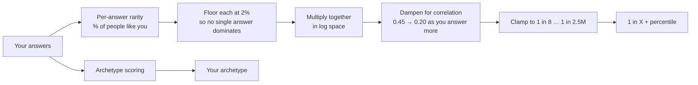

<div align="center">

# 1 in X

### Discover how rare you really are.

Answer 27 questions. Get your **1 in X** rarity score, percentile, archetype and rarest traits.

[](https://luciferalive.github.io/1inX/)
[](LICENSE)
[](CONTRIBUTING.md)

**[→ Play with the live demo](https://luciferalive.github.io/1inX/)** · [Report a bug](../../issues/new?template=bug_report.md) · [Suggest a feature](../../issues/new?template=feature_request.md)

</div>

---

## What is it?

1 in X compares your life, skills, habits and personality against rough global statistics and tells you
how statistically unusual you are, for example *"You're 1 in 917, rarer than 99.89% of people."*
Then it assigns you one of 12 archetypes, shows the traits that make you rarest, and lets you share the result.

> It's a fun estimate built on simplified public statistics, **not** science. Don't tattoo your score.

## Try it in 10 seconds

The **[live demo](https://luciferalive.github.io/1inX/)** runs entirely in your browser (nothing is sent anywhere).
Your score updates **live** as you answer, so try changing one answer and watch the number jump.

## Features

- 🎯 **27 questions** across Personal, Education, Career, Lifestyle, Travel, Skills, Technology and Personality
- 📉 **Calibrated rarity model** with believable bounds (never "100% rare", never "1 in a billion")
- 🎭 **12 archetypes** with strengths, weaknesses and taglines
- 🏆 **Leaderboards**, public profiles (`/u/<username>`) and a Discover page
- 🔗 **Referrals & achievements** with reward tiers
- 🖼️ **Share cards** rendered client-side as images
- 🔐 **Auth** via Supabase (email/password and Google)

## How the score works



Traits aren't independent (people who've visited 40 countries also tend to speak more languages), so the
raw product is *dampened*, and the more questions you answer, the stronger the dampening. Everything lives in
[`src/lib/rarity/`](src/lib/rarity):

| File | What it holds |
|---|---|
| [`questions.ts`](src/lib/rarity/questions.ts) | All 27 questions, answer options and their rarity % |
| [`engine.ts`](src/lib/rarity/engine.ts) | The scoring model (`hybrid-v1`) |
| [`archetypes.ts`](src/lib/rarity/archetypes.ts) | The 12 archetypes |

### The archetypes

| | Archetype | Tagline |
|---|---|---|
| 🌍 | **Global Deal Maker** | Borders bend around you. |
| ♟️ | **Silent Strategist** | You play three moves ahead. |
| ✈️ | **Digital Nomad** | Wi-Fi is your homeland. |
| 🌪️ | **Chaos Explorer** | Comfort is the enemy. |
| 📊 | **Data Warrior** | You argue with evidence, not opinion. |
| 🚀 | **Visionary Operator** | You see it. Then you ship it. |
| 🎭 | **Modern Renaissance** | Many crafts. One mind. |
| 🧠 | **Curious Thinker** | Why? then Why? again. |
| 🤝 | **World Connector** | Every room becomes warmer. |
| 🎨 | **Maverick Creator** | Rules are someone else's default. |
| 🌙 | **Night Owl Genius** | Your best ideas wake up at 2am. |
| 🛠️ | **Master Builder** | You finish what you start. |

## Tech stack

[TanStack Start](https://tanstack.com/start) · React 19 · TypeScript · Tailwind CSS 4 · Radix UI / shadcn ·
Motion · Supabase (Postgres + Auth) · Vite 7

## Run it locally

You need Node 20+ and a [Supabase](https://supabase.com) project.

```bash
git clone https://github.com/luciferalive/1inX.git
cd 1inX
npm install
cp .env.example .env      # then fill in your Supabase values
npm run dev
```

Apply the database schema from [`supabase/migrations/`](supabase/migrations) to your Supabase project
(with the [Supabase CLI](https://supabase.com/docs/guides/cli): `supabase db push`).

### Environment variables

| Variable | Where | Notes |
|---|---|---|
| `VITE_SUPABASE_URL` | browser + server | Your project URL |
| `VITE_SUPABASE_PUBLISHABLE_KEY` | browser + server | The public "anon" key (safe to expose; protect data with RLS) |
| `VITE_SUPABASE_PROJECT_ID` | browser + server | Your project ref |
| `SUPABASE_URL`, `SUPABASE_PUBLISHABLE_KEY`, `SUPABASE_PROJECT_ID` | server | Same values, read during SSR |
| `SUPABASE_SERVICE_ROLE_KEY` | **server only** | 🔴 Secret. Never commit it, never prefix it with `VITE_` |

### Good to know when self-hosting

- **Google sign-in** is routed through Lovable Cloud's auth helper
  ([`src/integrations/lovable`](src/integrations/lovable)). Email/password works with plain Supabase;
  for Google outside Lovable Cloud, swap in Supabase's own `signInWithOAuth`.
- **Build target.** The Vite config (`@lovable.dev/vite-tanstack-config`) builds for Cloudflare by default.
  If you host somewhere else, you may need to change the Nitro preset.

## Build your own site from this code

This project is fully open source (MIT). You're free to copy it, change it and launch your own version,
and there is no hosted site tied to this repo. To make your own:

1. **Fork** this repo (or click *Use this template* / download the code).
2. Create a free [Supabase](https://supabase.com) project and apply [`supabase/migrations/`](supabase/migrations).
3. Copy `.env.example` to `.env` and add your own Supabase values.
4. Run it locally with `npm install && npm run dev`, then `npm run build` when you're ready to deploy.
5. Make it yours: change the name, colors, questions ([`questions.ts`](src/lib/rarity/questions.ts)) and
   archetypes ([`archetypes.ts`](src/lib/rarity/archetypes.ts)).

Want a no-setup way to share something right away? The static [live demo](https://luciferalive.github.io/1inX/)
in [`docs/`](docs) needs no backend and can be hosted for free on any static host.

## The demo (GitHub Pages)

[`docs/index.html`](docs/index.html) is a single-file demo **generated from the real question and archetype data**,
so it can't drift from the app.

```bash
node scripts/build-demo.mjs          # regenerate docs/index.html
node scripts/check-demo-parity.mjs   # prove demo == real engine on 2,000 random profiles (Node 22.18+)
```

## Project structure

```text
src/
  routes/          file-based pages (/, /assessment, /results, /leaderboard, /u/$username …)
  lib/rarity/      questions, engine, archetypes  ← the heart of the project
  components/      UI building blocks (shadcn/ui + app components)
  integrations/    Supabase + auth wiring
supabase/migrations/   database schema + RLS policies
docs/              GitHub Pages demo
scripts/           demo generator + parity check
```

## Roadmap

- [ ] Real population data to replace the simulated baselines
- [ ] Celebrity-match system
- [ ] Country-level rarity with real demographics
- [ ] Admin dashboard
- [ ] More archetypes and more questions
- [ ] i18n

See [open issues](../../issues) for specific tasks. Look for **good first issue**.

## Contributing

Contributions of all sizes are welcome: new questions, better rarity numbers (with sources!), new archetypes,
UI polish, translations, bug fixes. Start with [CONTRIBUTING.md](CONTRIBUTING.md). The easiest first PR is
improving a rarity percentage in [`questions.ts`](src/lib/rarity/questions.ts) and citing where the number comes from.

## License

[MIT](LICENSE) © 2026 1inX contributors
